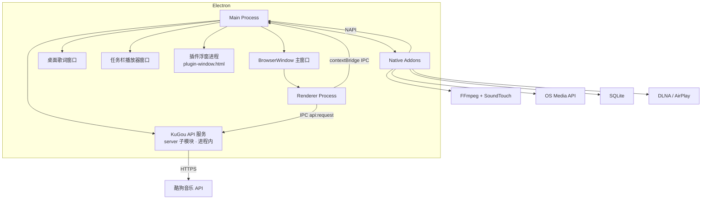
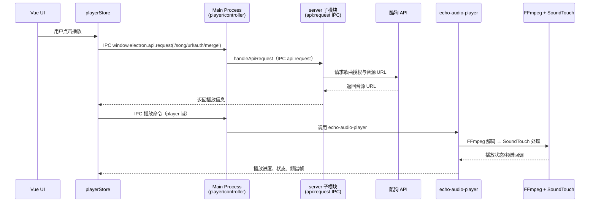
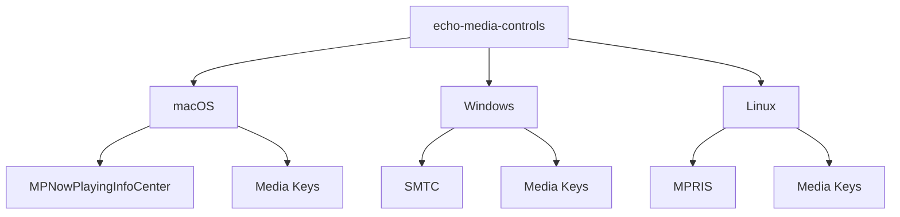

# 🏗️ 项目架构

本文介绍 EchoMusic 的整体架构设计，包括进程模型、数据流和核心组件。

## 进程模型

EchoMusic 基于 Electron 的多进程架构。酷狗 API 服务（KuGouMusicApi）以 git 子模块形式作为 pnpm workspace 成员**进程内**加载，渲染进程与主进程通过 IPC 直连通信，不依赖任何本地 HTTP 端口：

### Main Process（主进程）

运行在 Node.js 环境中，入口为 `src/main/index.ts`。主进程按子系统划分代码：

| 子系统 | 目录/文件 | 职责 |
|--------|-----------|------|
| IPC 桥接 | `ipc/` | 按域注册 IPC 处理器（player、settings、plugins、window、output 等 20+ 模块），统一经由 `ipc/registry.ts` |
| API 服务 | `server.ts` | 在进程内加载 `server/` 子模块，将渲染进程的 `api:request` IPC 请求路由到对应 module |
| 播放器 | `player/` | 播放控制器、会话、DSP Provider 注册、内嵌元数据等 |
| 媒体投放 | `mediaTransport/` | DLNA/UPnP 设备发现与控制、RAOP（AirPlay）适配、媒体服务器 |
| 输出管理 | `outputs/` | 本机/投放输出的会话管理与命令门控 |
| 插件子系统 | `plugins/` | 插件安装、插件源市场、文件授权、插件网络/TCP/SQLite 访问、插件浮窗管理（`windows.ts`） |
| 窗口管理 | `window/` | 窗口创建、背景材质（Mica/Acrylic/Hyprland blur）、全屏、窗口模式 |
| 桌面歌词 | `desktopLyric/` | 桌面歌词窗口与歌词状态存储 |
| 本地存储 | `storage/` | KV 存储、设置、播放队列、历史记录（经 echo-sqlite-store） |
| 外部歌单 | `external/` | 网易云、QQ 音乐、酷我、酷狗、汽水、Spotify、Apple Music 导入 |
| 系统集成 | `tray.ts`、`mediaControls.ts`、`powerMonitor.ts`、`systemShutdown.ts` 等 | 托盘、媒体控制、定时关机、开机自启等 |
| 更新 | `ipc/settings.ts` | 基于 electron-updater 的版本检测与安装 |

### Renderer Process（渲染进程）

运行在 Chromium 环境中，入口为 `src/renderer/main.ts`，负责：

- Vue 3 UI 渲染（主窗口、桌面歌词、任务栏播放器共用同一 Vite 构建，通过多个 HTML 入口区分）
- 用户交互处理
- 状态管理（Pinia，25+ 个 store）
- 通过 `window.electron.api.request(...)`（preload `contextBridge` 暴露）经 IPC 向主进程发起所有酷狗 API 请求
- 插件运行时：第三方插件的页面、音源、歌词与播放事件逻辑在渲染进程内执行

主窗口之外还有多个独立窗口/入口：桌面歌词（`desktop-lyric.html` + `src/desktop-lyric/`）、任务栏播放器（`taskbar-player.html` + `src/renderer/taskbarPlayer/`）、插件浮窗（`plugin-window.html` + `src/plugin-window/`）。

### Preload

`src/preload/index.ts` 通过 `contextBridge` 向渲染进程暴露类型化的 API 面（IPC 调用、事件订阅），是渲染进程与主进程之间唯一的通信通道。

## 音频播放管线

EchoMusic 的音频播放是最核心的链路：

### 核心播放器架构

`echo-audio-player` 是播放引擎的核心封装：

- 内嵌 vendored FFmpeg 解码 + SoundTouch 变速变调
- 支持淡入淡出、10 段 EQ、LUFS 响度标准化
- 倍速播放、设备切换、独占输出
- 实时频谱分析（FFT）、音效 DSP 滤镜链
- 播放事件回调（进度、状态变化等）

## 数据流

### 状态管理

使用 Pinia 4 进行全局状态管理。持久化不依赖第三方插件，而是通过自研的 `src/renderer/stores/sqlitePersist.ts` Pinia 插件实现：store 通过 `persist` 选项声明持久化范围（支持 `pick`/`omit` 字段过滤），数据经 IPC 写入主进程的 SQLite KV 存储（echo-sqlite-store）。

`src/renderer/stores/` 下有 25+ 个 store，主要包括：

| Store | 职责 |
|-------|------|
| `player.ts`（含 `player/` 子模块 20+ 文件） | 播放状态机、队列决策与执行、音频图、进度、睡眠定时器、听歌时长上报等 |
| `playlist.ts`（含 `playlist/` 子目录） | 歌单/收藏/队列操作、私人 FM 动作 |
| `user.ts` / `auth.ts` | 用户信息与登录态 |
| `setting.ts` | 应用设置、偏好配置 |
| `lyric.ts` | 歌词状态、翻译与偏移 |
| `theme.ts` | 主题与主题色 |
| `output.ts` | 播放输出（本机/投放）状态 |
| `historyStore.ts` | 播放历史 |
| `listenTogether.ts` | 一起听会话 |
| `device.ts` | 设备标识 |

### 网络请求

1. UI 通过 `window.electron.api.request()` 发起请求，经 preload 转为 `api:request` IPC 调用
2. 主进程 `src/main/server.ts` 的 `handleApiRequest` 匹配 `server/module/*.js` 中的对应模块（按文件名派生路由）并按需加载
3. module 调用酷狗音乐公开 API 并返回结果
4. 响应经 IPC 返回渲染进程；音频流 URL 直接交给 echo-audio-player 播放

## 插件子系统进程模型

- **插件运行时**：插件代码（页面、音源、歌词、播放事件监听）在渲染进程环境中执行，可声明自定义页面、侧边栏入口、设置项、播放器按钮与右键菜单
- **插件浮窗**：插件可声明独立浮窗页面，运行在 `plugin-window.html` 入口加载的独立窗口进程中（`src/plugin-window/`）
- **主进程侧**：`src/main/plugins/` 负责插件安装事务、插件源市场缓存、文件系统授权、插件专属网络/TCP/SQLite 访问通道
- 插件运行在受信任的本地扩展环境中，并非浏览器扩展沙盒，安装前请确认来源可信

## 系统集成架构

`echo-media-controls` 模块实现各平台系统集成：

## 安全设计

- 账号密码只在登录时传递，不本地存储明文密码
- 所有 API 请求通过 HTTPS 加密
- 本地数据存储在用户目录的隔离空间中
- 插件的文件系统、网络与 TCP 访问需要显式授权（`src/main/plugins/fileGrants.ts`）
- 不收集、不上传用户个人信息
