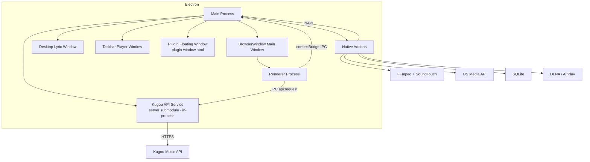
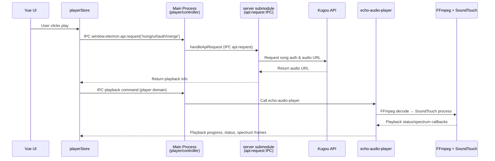
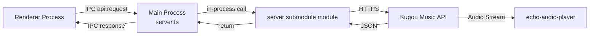
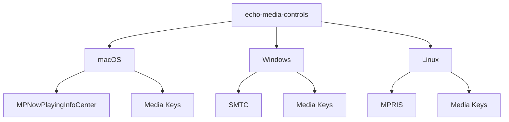

# 🏗️ Architecture

This document describes EchoMusic's overall architecture design, including the process model, data flow, and core components.

## Process Model

EchoMusic is based on Electron's multi-process architecture. The Kugou API service (KuGouMusicApi) is loaded **in-process** as a git submodule and pnpm workspace member. The renderer communicates with the main process directly over IPC without relying on any local HTTP port:

### Main Process

Runs in the Node.js environment with the entry point at `src/main/index.ts`. The main process code is organized into subsystems:

| Subsystem | Directory/File | Responsibility |
|--------|-----------|------|
| IPC Bridge | `ipc/` | Registers IPC handlers per domain (player, settings, plugins, window, output, etc., 20+ modules) through a unified `ipc/registry.ts` |
| API Service | `server.ts` | Loads the `server/` submodule in-process and routes renderer `api:request` IPC calls to the corresponding module |
| Player | `player/` | Playback controller, session, DSP provider registry, embedded metadata, etc. |
| Media Transport | `mediaTransport/` | DLNA/UPnP device discovery and control, RAOP (AirPlay) adapter, media server |
| Output Management | `outputs/` | Session management and command gating for local/cast playback outputs |
| Plugin Subsystem | `plugins/` | Plugin installation, marketplace, file grants, plugin network/TCP/SQLite access, plugin floating window management (`windows.ts`) |
| Window Management | `window/` | Window creation, background materials (Mica/Acrylic/Hyprland blur), fullscreen, window modes |
| Desktop Lyrics | `desktopLyric/` | Desktop lyric window and lyric state store |
| Local Storage | `storage/` | KV storage, settings, playback queues, history (via echo-sqlite-store) |
| External Playlists | `external/` | Import from Netease Cloud Music, QQ Music, Kuwo, Kugou, Qishui, Spotify, Apple Music |
| System Integration | `tray.ts`, `mediaControls.ts`, `powerMonitor.ts`, `systemShutdown.ts`, etc. | Tray, media controls, scheduled shutdown, auto-start, etc. |
| Updates | `ipc/settings.ts` | Version check and install based on electron-updater |

### Renderer Process

Runs in the Chromium environment with the entry point at `src/renderer/main.ts`, responsible for:

- Vue 3 UI rendering (the main window, desktop lyrics, and taskbar player share the same Vite build via multiple HTML entries)
- User interaction handling
- State management (Pinia, 25+ stores)
- Sending all Kugou API requests to the main process over IPC via `window.electron.api.request(...)` (exposed by the preload `contextBridge`)
- Plugin runtime: third-party plugin pages, audio sources, lyrics, and playback event logic execute inside the renderer

Besides the main window, there are several standalone windows/entries: desktop lyrics (`desktop-lyric.html` + `src/desktop-lyric/`), the taskbar player (`taskbar-player.html` + `src/renderer/taskbarPlayer/`), and plugin floating windows (`plugin-window.html` + `src/plugin-window/`).

### Preload

`src/preload/index.ts` exposes a typed API surface (IPC invocations and event subscriptions) to the renderer via `contextBridge`. It is the only communication channel between the renderer and the main process.

## Audio Playback Pipeline

EchoMusic's audio playback is the core pipeline:

### Core Player Architecture

`echo-audio-player` is the core wrapper of the playback engine:

- Embeds vendored FFmpeg decoding + SoundTouch tempo/pitch processing
- Supports crossfade, 10-band EQ, LUFS loudness normalization
- Speed control, device switching, exclusive output
- Real-time spectrum analysis (FFT), DSP audio effect filter chain
- Playback event callbacks (progress, status changes, etc.)

## Data Flow

### State Management

Uses Pinia 4 for global state management. Persistence does not rely on any third-party plugin; instead, a custom Pinia plugin at `src/renderer/stores/sqlitePersist.ts` is used: stores declare their persistence scope via the `persist` option (with `pick`/`omit` field filtering), and data is written over IPC into the main process SQLite KV store (echo-sqlite-store).

There are 25+ stores under `src/renderer/stores/`, including:

| Store | Responsibility |
|-------|------|
| `player.ts` (with 20+ files under `player/`) | Playback state machine, queue decision & execution, audio graph, progress, sleep timer, listening-time reporting, etc. |
| `playlist.ts` (with the `playlist/` subdirectory) | Playlist/favorite/queue actions, Personal FM actions |
| `user.ts` / `auth.ts` | User info and login state |
| `setting.ts` | Application settings and preferences |
| `lyric.ts` | Lyric state, translation, and offset |
| `theme.ts` | Theme and accent colors |
| `output.ts` | Playback output (local/cast) state |
| `historyStore.ts` | Playback history |
| `listenTogether.ts` | Listen Together sessions |
| `device.ts` | Device identity |

### Network Requests

1. The UI sends requests via `window.electron.api.request()`, which the preload turns into an `api:request` IPC call
2. `handleApiRequest` in `src/main/server.ts` matches the corresponding module under `server/module/*.js` (routes derived from file names) and lazy-loads it
3. The module calls the Kugou Music public API and returns the result
4. The response goes back to the renderer over IPC; the audio stream URL is handed directly to echo-audio-player for playback

## Plugin Subsystem Process Model

- **Plugin runtime**: plugin code (pages, audio sources, lyrics, playback event listeners) executes in the renderer environment and can declare custom pages, sidebar entries, settings, player buttons, and context menus
- **Plugin floating windows**: plugins can declare standalone floating window pages, which run in a separate window process loaded from the `plugin-window.html` entry (`src/plugin-window/`)
- **Main process side**: `src/main/plugins/` handles plugin install transactions, marketplace caching, file system grants, and plugin-specific network/TCP/SQLite access channels
- Plugins run in a trusted local extension environment, not a browser extension sandbox; only install plugins from trusted sources

## System Integration Architecture

The `echo-media-controls` module implements platform-specific system integration:

## Security Design

- Account passwords are only transmitted during login — no plaintext passwords stored locally
- All API requests use HTTPS encryption
- Local data is stored in an isolated space within the user directory
- Plugin file system, network, and TCP access require explicit grants (`src/main/plugins/fileGrants.ts`)
- No user personal information is collected or uploaded
